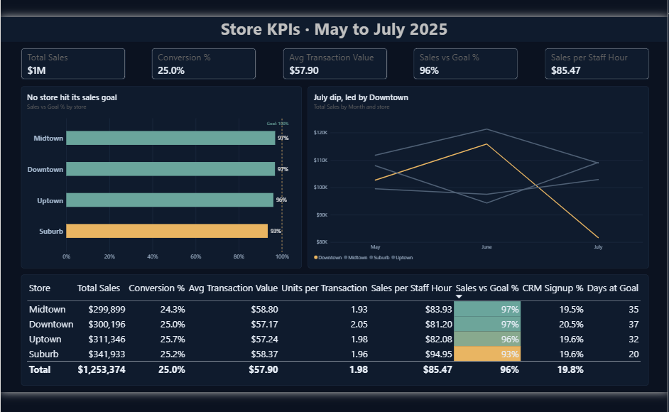

# Retail Store KPIs: PostgreSQL and Power BI

**Which of 4 stores is turning traffic into sales, and why is none of them hitting its sales goal?**

Three months of daily data (May to July 2025) for 4 stores. I calculated the core store KPIs in PostgreSQL, by day, week, month, quarter and year, and built a one-page Power BI dashboard to show where each store stands against its goal.



📥 **[Download the Power BI file](retail_kpis.pbix)** · **[See the SQL](kpis.sql)**

## Key findings

| | Finding | Action |
|---|---|---|
| 🎯 | **No store hit its sales goal.** Together they reached **95.7%**, about **$57,000** short over the 3 months. | Review goals and staffing store by store, not as one target. |
| 🏬 | **Suburb** sells the most (**$341,933**) and makes the most per staff hour (**$94.95**), yet it's furthest behind goal (**93.4%**) and hit goal on only **20 of 92 days**. | Re-base Suburb's goal: it's the strongest store, so a goal it misses 3 days in 4 is probably set too high. |
| 📉 | **Downtown's July sales fell 29%** ($115,840 → $81,681). Traffic fell 15%, conversion dropped from **26.4% to 22.6%**, but staff hours **went up 9%**, so sales per staff hour fell from **$100 to $65**. | Schedule Downtown's staff to its traffic, and find out why fewer visitors bought. |

**Recommendation:** Start with Downtown. At June's conversion rate, its July traffic would have brought in about **$13,700** more. Fixing conversion and matching staff hours to traffic is the quickest win, then re-base Suburb's goal so it measures real performance.

## Built with
PostgreSQL (CTEs, `DATE_TRUNC`, `EXTRACT`, `NULLIF` for safe division) · Power BI (DAX measures, conditional formatting, a custom theme)

---

## The KPIs

| KPI | Formula | What it tells you |
|---|---|---|
| Conversion % | transactions ÷ traffic | How many visitors bought something |
| Avg transaction value | sales ÷ transactions | How much each purchase was worth |
| Units per transaction | units sold ÷ transactions | How many items went in each basket |
| Sales per staff hour | sales ÷ staff hours | How productive the team was |
| Sales vs goal % | sales ÷ sales goal | How close the store came to its target |
| CRM sign-up % | CRM sign-ups ÷ transactions | How many buyers joined the loyalty list |
| Days at goal | days where sales ≥ goal | How often the store hit its target |

Weekly, monthly and quarterly KPIs are worked out as **total ÷ total** (for example all transactions ÷ all traffic), not as an average of daily rates, so busy days count for more.

## How to run it

1. **Create the table in PostgreSQL** (pgAdmin 4):
   ```sql
   CREATE TABLE retail_sales (
     date DATE,
     store_id VARCHAR(50),
     traffic_count INTEGER,
     transactions INTEGER,
     sales NUMERIC,
     units_sold INTEGER,
     staff_hours NUMERIC,
     crm_signups INTEGER,
     repeat_customers INTEGER,
     sales_goal NUMERIC
   );
   ```
2. **Import `retail_sales.csv`:** right-click the table → Import/Export Data → choose the file, with **Header** on. Columns load in order, so the CSV's `store` and `traffic` fill `store_id` and `traffic_count`.
3. **Run `kpis.sql`.** It returns daily, weekly, monthly, quarterly and yearly KPIs per store. The results are saved as the `* KPI per Store.csv` files.
4. **Open `retail_kpis.pbix`** in Power BI Desktop to see the dashboard. It reads `retail_sales.csv`.

## About the data
- Simulated data: 4 stores × 92 days = **368 rows**, from 1 May to 31 July 2025.
- **No missing values or duplicates**, so no cleaning was needed.
- **Quarters are partial:** Q2 2025 covers May and June only, and Q3 2025 covers July only. The yearly figures are the 3-month total.
- **A data quirk worth flagging:** on **117 of 368** days, units sold exactly equals transactions (one item per basket). In real data I'd check this with the store team before trusting units per transaction.

## Repo layout
```
retail_sales.csv            the raw daily data
kpis.sql                    all the KPI queries
* KPI per Store.csv         the query results (daily to yearly)
retail_kpis.pbix            the Power BI dashboard
images/dashboard.png        the dashboard screenshot
README.md
```
